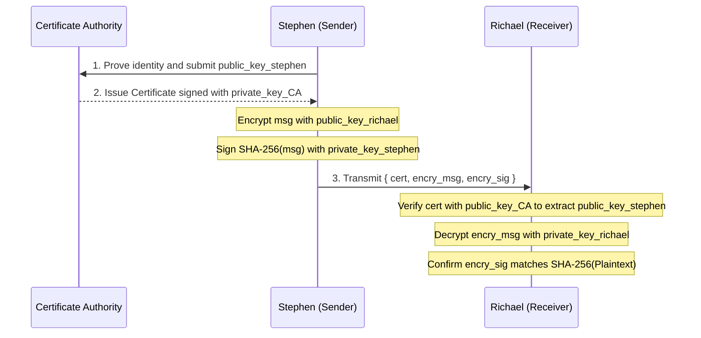

## Introduction

Information is power, yet transmitting it safely across an untrusted network is tricky. Any practical communication channel has to solve at least two distinct problems: **Confidentiality** and **Integrity**.

- **Confidentiality (RSA Encryption):** No eavesdropper on the wire can read the plaintext message other than the intended recipient.
- **Integrity & Authenticity (Digital Signatures & Certificates):** No attacker in the middle of transmission can silently swap or truncate the payload, or impersonate the sender, without the recipient immediately detecting it.

This note builds RSA encryption, SHA-256 digital signatures, and a toy Certificate Authority (CA) in pure Python first so the mechanics (*what* and *how*) are concrete, then walks through the underlying modular arithmetic (*why* it works) and how production cryptography hardens these primitives.

## Rivest, Shamir, and Adleman (RSA) Cryptosystem


*Ron Rivest, Adi Shamir, and Leonard Adleman at MIT (1977).*

### Helper Functions

<details class="nb-collapse">
<summary>Show standard library imports</summary>

```python
import ast
import base64
import random
from hashlib import sha256
```

</details>

#### Check If a Number Is Prime

```python
def check_prime(num):
    """Check whether num is a prime integer."""
    if num > 1:
        for i in range(2, int(num ** 0.5) + 1):
            if (num % i) == 0:
                return False
        return True
    return False
```

#### Modular Multiplicative Inverse (Extended Euclidean Algorithm)

Given public exponent $e$ and Euler's totient $\varphi(n)$, we need a private exponent $k$ satisfying $e \cdot k \equiv 1 \pmod{\varphi(n)}$:

```python
# Adapted from https://stackoverflow.com/a/9758173/3317548
def egcd(a, b):
    if a == 0:
        return (b, 0, 1)
    else:
        g, y, x = egcd(b % a, a)
        return (g, x - (b // a) * y, y)


def modinv(a, m):
    g, x, y = egcd(a, m)
    if g != 1:
        raise ValueError("Modular inverse does not exist (a and m are not coprime)")
    else:
        aa = x % m
        bb = int((1 - a * aa) / m)
        return aa, bb
```

#### List All Prime Numbers Smaller Than `n`

```python
# Sieve of Eratosthenes: https://stackoverflow.com/q/2068372/3317548
def find_prime(n):
    """Return a list of all primes strictly less than n."""
    sieve = [True] * (n // 2)
    for i in range(3, int(n ** 0.5) + 1, 2):
        if sieve[i // 2]:
            sieve[i * i // 2 :: i] = [False] * ((n - i * i - 1) // (2 * i) + 1)
    return [2] + [2 * i + 1 for i in range(1, n // 2) if sieve[i]]
```

### Encryption & Decryption Process

Suppose **Richael** wants her friends to send her confidential messages over an open network:

- **Richael (Receiver)** generates a mathematical key pair: a **public key** and a **private key**.
- She keeps the **private key** strictly secret on her own machine.
- She publishes her **public key** openly so anyone (for example, **Stephen**) can fetch a copy:
  - Stephen wants to send Richael the message: `"Hello Richael. Let's meet at 6:25 pm tomorrow at the airport Gate5, Terminal 2 --Stephen :)"`.
  - Stephen encrypts that plaintext using Richael's **public key**, turning it into an opaque ciphertext string (`"MHgzNjYyZAoweDQ4NWI4..."`).
  - Stephen transmits the ciphertext over the network to Richael.
- Upon receiving the ciphertext, Richael applies her **private key** to recover the exact original plaintext: `"Hello Richael. Let's meet at 6:25 pm tomorrow at the airport Gate5, Terminal 2 --Stephen :)"`.
- Because only Richael holds her **private key**, nobody else watching the network can invert the ciphertext generated under her **public key**.
- If Richael wants to send an encrypted reply back to Stephen, she repeats the exact same flow using **Stephen's public key**.

#### Key Pair Generation: Public & Private (Richael's Task)

1. Randomly pick two distinct prime numbers $p$ and $q$ (in real systems, thousands of bits wide).
2. Compute the modulus via multiplication: $n = p \times q$.
3. Compute Euler's totient: $\varphi(n) = (p - 1)(q - 1)$.
4. Pick a public exponent $e$ in $1 < e < \varphi(n)$ such that $\gcd(e, \varphi(n)) = 1$ (picking a prime not dividing $\varphi(n)$ guarantees coprimality).
5. Compute the modular multiplicative inverse $k$ of $e$ modulo $\varphi(n)$, so $e \cdot k \equiv 1 \pmod{\varphi(n)}$.
6. **Public Key:** $(n, e)$
7. **Private Key:** $(n, k)$

```python
# Pick two distinct prime numbers
p = random.choice(list(find_prime(1024)))
q = random.choice(list(find_prime(1024)))
assert check_prime(p)
assert check_prime(q)
n = p * q
p, q, n, len(bin(n)), bin(n)
```

<pre class="nb-output"><code>(661, 937, 619357, 22, &#x27;0b10010111001101011101&#x27;)</code></pre>

```python
# Euler's totient phi(n)
phi = (p - 1) * (q - 1)
phi
```

<pre class="nb-output"><code>617760</code></pre>

```python
e = random.choice(find_prime(phi))
assert check_prime(e)
e
```

<pre class="nb-output"><code>267781</code></pre>

```python
k = modinv(e, phi)[0]
k
```

<pre class="nb-output"><code>418381</code></pre>

```python
public_key, private_key = (n, e), (n, k)
public_key, private_key
```

<pre class="nb-output"><code>((619357, 267781), (619357, 418381))</code></pre>

#### Encryption & Decryption Computation

For each integer message symbol $m$ satisfying $0 \le m < n$:

- **Encrypt with Public Key $(n, e)$:** $c = m^e \bmod n$
- **Decrypt with Private Key $(n, k)$:** $m = c^k \bmod n$


#### Original Message Encoding (Stephen's Task)

```python
# Convert each character to its Unicode code point
msg = [ord(i) for i in "Hello Richael. Let's meet at 6:25 pm tomorrow at the airport Gate5, Terminal 2 --Stephen :)"]
msg
```

<details class="nb-collapse">
<summary>Show cell output</summary>
<pre class="nb-output"><code>[72,
 101,
 108,
 108,
 111,
 32,
 82,
 105,
 99,
 104,
 97,
 101,
 108,
 46,
 32,
 76,
 101,
 116,
 39,
 115,
 32,
 109,
 101,
 101,
 116,
 32,
 97,
 116,
 32,
 54,
 58,
 50,
 53,
 32,
 112,
 109,
 32,
 116,
 111,
 109,
 111,
 114,
 114,
 111,
 119,
 32,
 97,
 116,
 32,
 116,
 104,
 101,
 32,
 97,
 105,
 114,
 112,
 111,
 114,
 116,
 32,
 71,
 97,
 116,
 101,
 53,
 44,
 32,
 84,
 101,
 114,
 109,
 105,
 110,
 97,
 108,
 32,
 50,
 32,
 45,
 45,
 83,
 116,
 101,
 112,
 104,
 101,
 110,
 32,
 58,
 41]</code></pre>
</details>

#### Encryption (Stephen's Task)

```python
# Modular exponentiation with Richael's public key (n, e)
[(val ** public_key[1]) % public_key[0] for val in msg]
```

<details class="nb-collapse">
<summary>Show cell output</summary>
<pre class="nb-output"><code>[222765,
 296376,
 38066,
 38066,
 408826,
 219882,
 396632,
 14888,
 300842,
 485110,
 170726,
 296376,
 38066,
 502089,
 219882,
 38269,
 296376,
 491916,
 396672,
 583480,
 219882,
 401835,
 296376,
 296376,
 491916,
 219882,
 170726,
 491916,
 219882,
 417590,
 378540,
 522901,
 213362,
 219882,
 281867,
 401835,
 219882,
 491916,
 408826,
 401835,
 408826,
 461741,
 461741,
 408826,
 21932,
 219882,
 170726,
 491916,
 219882,
 491916,
 485110,
 296376,
 219882,
 170726,
 14888,
 461741,
 281867,
 408826,
 461741,
 491916,
 219882,
 537464,
 170726,
 491916,
 296376,
 213362,
 424907,
 219882,
 357364,
 296376,
 461741,
 401835,
 14888,
 229696,
 170726,
 38066,
 219882,
 522901,
 219882,
 71132,
 71132,
 570194,
 491916,
 296376,
 281867,
 485110,
 296376,
 229696,
 219882,
 378540,
 388376]</code></pre>
</details>

```python
# Hex-encode each encrypted integer
encry_msg = '\n'.join([hex((val ** public_key[1]) % public_key[0]) for val in msg])
encry_msg
```

<details class="nb-collapse">
<summary>Show cell output</summary>
<pre class="nb-output"><code>&#x27;0x3662d\n0x485b8\n0x94b2\n0x94b2\n0x63cfa\n0x35aea\n0x60d58\n0x3a28\n0x4972a\n0x766f6\n0x29ae6\n0x485b8\n0x94b2\n0x7a949\n0x35aea\n0x957d\n0x485b8\n0x7818c\n0x60d80\n0x8e738\n0x35aea\n0x621ab\n0x485b8\n0x485b8\n0x7818c\n0x35aea\n0x29ae6\n0x7818c\n0x35aea\n0x65f36\n0x5c6ac\n0x7fa95\n0x34172\n0x35aea\n0x44d0b\n0x621ab\n0x35aea\n0x7818c\n0x63cfa\n0x621ab\n0x63cfa\n0x70bad\n0x70bad\n0x63cfa\n0x55ac\n0x35aea\n0x29ae6\n0x7818c\n0x35aea\n0x7818c\n0x766f6\n0x485b8\n0x35aea\n0x29ae6\n0x3a28\n0x70bad\n0x44d0b\n0x63cfa\n0x70bad\n0x7818c\n0x35aea\n0x83378\n0x29ae6\n0x7818c\n0x485b8\n0x34172\n0x67bcb\n0x35aea\n0x573f4\n0x485b8\n0x70bad\n0x621ab\n0x3a28\n0x38140\n0x29ae6\n0x94b2\n0x35aea\n0x7fa95\n0x35aea\n0x115dc\n0x115dc\n0x8b352\n0x7818c\n0x485b8\n0x44d0b\n0x766f6\n0x485b8\n0x38140\n0x35aea\n0x5c6ac\n0x5ed18&#x27;</code></pre>
</details>

```python
# Base64-encode for transport
encry_msg = base64.b64encode(encry_msg.encode('utf8'))
encry_msg
```

<details class="nb-collapse">
<summary>Show cell output</summary>
<pre class="nb-output"><code>b&#x27;MHgzNjYyZAoweDQ4NWI4CjB4OTRiMgoweDk0YjIKMHg2M2NmYQoweDM1YWVhCjB4NjBkNTgKMHgzYTI4CjB4NDk3MmEKMHg3NjZmNgoweDI5YWU2CjB4NDg1YjgKMHg5NGIyCjB4N2E5NDkKMHgzNWFlYQoweDk1N2QKMHg0ODViOAoweDc4MThjCjB4NjBkODAKMHg4ZTczOAoweDM1YWVhCjB4NjIxYWIKMHg0ODViOAoweDQ4NWI4CjB4NzgxOGMKMHgzNWFlYQoweDI5YWU2CjB4NzgxOGMKMHgzNWFlYQoweDY1ZjM2CjB4NWM2YWMKMHg3ZmE5NQoweDM0MTcyCjB4MzVhZWEKMHg0NGQwYgoweDYyMWFiCjB4MzVhZWEKMHg3ODE4YwoweDYzY2ZhCjB4NjIxYWIKMHg2M2NmYQoweDcwYmFkCjB4NzBiYWQKMHg2M2NmYQoweDU1YWMKMHgzNWFlYQoweDI5YWU2CjB4NzgxOGMKMHgzNWFlYQoweDc4MThjCjB4NzY2ZjYKMHg0ODViOAoweDM1YWVhCjB4MjlhZTYKMHgzYTI4CjB4NzBiYWQKMHg0NGQwYgoweDYzY2ZhCjB4NzBiYWQKMHg3ODE4YwoweDM1YWVhCjB4ODMzNzgKMHgyOWFlNgoweDc4MThjCjB4NDg1YjgKMHgzNDE3MgoweDY3YmNiCjB4MzVhZWEKMHg1NzNmNAoweDQ4NWI4CjB4NzBiYWQKMHg2MjFhYgoweDNhMjgKMHgzODE0MAoweDI5YWU2CjB4OTRiMgoweDM1YWVhCjB4N2ZhOTUKMHgzNWFlYQoweDExNWRjCjB4MTE1ZGMKMHg4YjM1MgoweDc4MThjCjB4NDg1YjgKMHg0NGQwYgoweDc2NmY2CjB4NDg1YjgKMHgzODE0MAoweDM1YWVhCjB4NWM2YWMKMHg1ZWQxOA==&#x27;</code></pre>
</details>

#### Decryption (Richael's Task)

```python
# Base64-decode and parse hex integers
[int(i, 16) for i in base64.b64decode(encry_msg).decode('utf8').split('\n')]
```

<details class="nb-collapse">
<summary>Show cell output</summary>
<pre class="nb-output"><code>[222765,
 296376,
 38066,
 38066,
 408826,
 219882,
 396632,
 14888,
 300842,
 485110,
 170726,
 296376,
 38066,
 502089,
 219882,
 38269,
 296376,
 491916,
 396672,
 583480,
 219882,
 401835,
 296376,
 296376,
 491916,
 219882,
 170726,
 491916,
 219882,
 417590,
 378540,
 522901,
 213362,
 219882,
 281867,
 401835,
 219882,
 491916,
 408826,
 401835,
 408826,
 461741,
 461741,
 408826,
 21932,
 219882,
 170726,
 491916,
 219882,
 491916,
 485110,
 296376,
 219882,
 170726,
 14888,
 461741,
 281867,
 408826,
 461741,
 491916,
 219882,
 537464,
 170726,
 491916,
 296376,
 213362,
 424907,
 219882,
 357364,
 296376,
 461741,
 401835,
 14888,
 229696,
 170726,
 38066,
 219882,
 522901,
 219882,
 71132,
 71132,
 570194,
 491916,
 296376,
 281867,
 485110,
 296376,
 229696,
 219882,
 378540,
 388376]</code></pre>
</details>

```python
# RSA decryption with Richael's private key (n, k)
decry_msg = [
    int(i, 16) ** private_key[1] % private_key[0]
    for i in base64.b64decode(encry_msg).decode("utf8").split("\n")
]
print(decry_msg)
print("".join([chr(i) for i in decry_msg]))
```

<pre class="nb-output"><code>[72, 101, 108, 108, 111, 32, 82, 105, 99, 104, 97, 101, 108, 46, 32, 76, 101, 116, 39, 115, 32, 109, 101, 101, 116, 32, 97, 116, 32, 54, 58, 50, 53, 32, 112, 109, 32, 116, 111, 109, 111, 114, 114, 111, 119, 32, 97, 116, 32, 116, 104, 101, 32, 97, 105, 114, 112, 111, 114, 116, 32, 71, 97, 116, 101, 53, 44, 32, 84, 101, 114, 109, 105, 110, 97, 108, 32, 50, 32, 45, 45, 83, 116, 101, 112, 104, 101, 110, 32, 58, 41]
Hello Richael. Let&#x27;s meet at 6:25 pm tomorrow at the airport Gate5, Terminal 2 --Stephen :)</code></pre>

### Why Is This Secure?


*Leonhard Euler (1707-1783). He changed the world and shows up everywhere in mathematics; remember Euler and his theorems, or you will struggle in a math exam sooner or later.*

Suppose a curious acquaintance (**Tom**) or a network eavesdropper (**Joseph**) intercepts the wire traffic between Stephen and Richael:

- Both Tom and Joseph can see:
  - $n$ and $e$ from Richael's broadcast **public key**.
  - `encry_msg` because Stephen sent it across the network.
- To decrypt `encry_msg`, an attacker needs Richael's **private key** $(n, k)$:
  1. $n$ is already public, so they only need to recover $k$.
  2. $k$ is computed deterministically from $e$ and $\varphi(n)$ via `modinv(e, phi)`.
  3. $e$ is public, so recovering $k$ reduces to computing $\varphi(n) = (p - 1)(q - 1)$.
  4. Computing $\varphi(n)$ requires knowing the secret prime factors $p$ and $q$.
  5. Recovering $p$ and $q$ from $n$ requires **prime factorization** of $n = p \times q$.
- While factoring `619357 = 661 * 937` takes microseconds in our toy demo, factoring a modern **2048-bit or 4096-bit RSA modulus** (hundreds of decimal digits) remains computationally infeasible on classical supercomputers such as [Fugaku](https://en.wikipedia.org/wiki/TOP500) -- Tom and Joseph would be long gone before recovering $p$ and $q$, let alone before `"6:25 pm tomorrow"`.
- Rotating keys periodically limits exposure further, unless an adversary eventually builds a fault-tolerant [cryptographically relevant quantum computer](https://www.newscientist.com/article/2227387-quantum-computer-sets-new-record-for-finding-prime-number-factors/) capable of running Shor's algorithm at scale.

### Investigate and Understand Your Own Machine

If you inspect `~/.ssh` on a Linux or macOS machine, you will find pairs of private and public key files generated by OpenSSH or OpenSSL (encoded with ASN.1 DER/PEM structures or OpenSSH's key format).

- Export an RSA public key to PEM format via:

```bash
ssh-keygen -f YOUR_KEY.pub -e -m pem > YOUR_KEY.pub.pem
```

- Inspect the mathematical components in Python using `PyCryptodome` (`pip install pycryptodome`, the maintained drop-in successor to legacy `PyCrypto`):

```python
from Crypto.PublicKey import RSA
from base64 import b64decode

pem_key = b"MII<DO NOT SHARE PRIVATE KEY>="
key = b64decode(pem_key)
key_priv = RSA.import_key(key)

# A private key stores n, e, d (our k), p, q, and CRT coefficient u
print(key_priv.n, key_priv.e, key_priv.d, key_priv.p, key_priv.q, key_priv.u)
assert key_priv.p * key_priv.q == key_priv.n
```

By contrast, importing `*.pub.pem` exposes **only** the public components `n` and `e`. Similarly, inspecting `~/.ssh/known_hosts` reveals one line per trusted remote host:

```text
<domain_name,ip_address> <algorithm, e.g. rsa-sha2-512 or ssh-ed25519> <public_key>
```

During an SSH handshake, your client uses that host public key to verify the server's cryptographic identity so an attacker on local Wi-Fi cannot silently impersonate your remote machine.

## Digital Signature

Confidentiality alone does not guarantee **authenticity** or **integrity**:

1. **Spoofing:** What if Joseph pretends to be Stephen, encrypts `"Hello Richael. Let's meet at 6:25 am the day after tomorrow at the train station Gate 1 :)"` using Richael's public key, and sends it to Richael? Anyone has Richael's public key -- how can Richael tell whether Stephen actually wrote it?
2. **Tampering in Transit:** What if Joseph intercepts Stephen's `encry_msg` and truncates or corrupts part of the Base64 payload before forwarding it to Richael? Even without Richael's private key, Joseph can strip away the meeting location:

```python
encry_msg_alter = base64.b64encode(
    "\n".join(base64.b64decode(encry_msg).decode("utf8").split("\n")[:33]).encode(
        "utf8"
    )
)
encry_msg_alter
```

<pre class="nb-output"><code>b&#x27;MHgzNjYyZAoweDQ4NWI4CjB4OTRiMgoweDk0YjIKMHg2M2NmYQoweDM1YWVhCjB4NjBkNTgKMHgzYTI4CjB4NDk3MmEKMHg3NjZmNgoweDI5YWU2CjB4NDg1YjgKMHg5NGIyCjB4N2E5NDkKMHgzNWFlYQoweDk1N2QKMHg0ODViOAoweDc4MThjCjB4NjBkODAKMHg4ZTczOAoweDM1YWVhCjB4NjIxYWIKMHg0ODViOAoweDQ4NWI4CjB4NzgxOGMKMHgzNWFlYQoweDI5YWU2CjB4NzgxOGMKMHgzNWFlYQoweDY1ZjM2CjB4NWM2YWMKMHg3ZmE5NQoweDM0MTcy&#x27;</code></pre>

```python
# Richael decrypts the truncated payload without realizing bytes were stripped
decry_msg = [
    int(i, 16) ** private_key[1] % private_key[0]
    for i in base64.b64decode(encry_msg_alter).decode("utf8").split("\n")
]
print(decry_msg)
print("".join([chr(i) for i in decry_msg]))
```

<pre class="nb-output"><code>[72, 101, 108, 108, 111, 32, 82, 105, 99, 104, 97, 101, 108, 46, 32, 76, 101, 116, 39, 115, 32, 109, 101, 101, 116, 32, 97, 116, 32, 54, 58, 50, 53]
Hello Richael. Let&#x27;s meet at 6:25</code></pre>

### Two-Way RSA Keys

To prove authorship, the sender (**Stephen**) also generates his own RSA key pair, keeping `private_key_stephen` secret and sharing `public_key_stephen`:

```python
# Stephen generates his own key pair
p = random.choice(list(find_prime(1024)))
q = random.choice(list(find_prime(1024)))
assert check_prime(p)
assert check_prime(q)
n = p * q

phi = (p - 1) * (q - 1)
e = random.choice(find_prime(phi))
assert check_prime(e)
k = modinv(e, phi)[0]

public_key_stephen, private_key_stephen = (n, e), (n, k)
public_key_stephen, private_key_stephen
```

<pre class="nb-output"><code>((111047, 28409), (111047, 73505))</code></pre>

### Hashing & Signing

Before transmitting his message, Stephen computes a fixed-length **SHA-256 digest** of the plaintext:

```python
signature = sha256(
    b"Hello Richael. Let's meet at 6:25 pm tomorrow at the airport Gate5, Terminal 2 --Stephen :)"
).hexdigest()
signature
```

<pre class="nb-output"><code>&#x27;22edc929d9211d1102f7af88b85ea472c9e64629074985cba94607526dff3029&#x27;</code></pre>

Stephen then signs that digest using his **own private key** $(n_{\text{Stephen}}, k_{\text{Stephen}})$:

```python
encry_sig = "\n".join(
    [
        hex((ord(val) ** private_key_stephen[1]) % private_key_stephen[0])
        for val in signature
    ]
)

encry_sig = base64.b64encode(encry_sig.encode("utf8"))
encry_sig
```

<pre class="nb-output"><code>b&#x27;MHhkMzUxCjB4ZDM1MQoweDE3MTAKMHgxNThmYwoweDFhZmJmCjB4ZDUyYgoweGQzNTEKMHhkNTJiCjB4MTU4ZmMKMHhkNTJiCjB4ZDM1MQoweDEwY2IyCjB4MTBjYjIKMHgxNThmYwoweDEwY2IyCjB4MTBjYjIKMHg1MDNiCjB4ZDM1MQoweGIwNTAKMHgxNDljNAoweDFhMjVmCjB4YjA1MAoweDE3YTBkCjB4MTdhMGQKMHgxYWZlNAoweDE3YTBkCjB4NDRlOAoweDE3MTAKMHgxYTI1ZgoweDE4NmE1CjB4MTQ5YzQKMHhkMzUxCjB4MWFmYmYKMHhkNTJiCjB4MTcxMAoweDVmNzIKMHgxODZhNQoweDVmNzIKMHhkMzUxCjB4ZDUyYgoweDUwM2IKMHgxNDljNAoweDE4NmE1CjB4ZDUyYgoweDE3YTBkCjB4NDRlOAoweDFhZmJmCjB4MWFmZTQKMHgxYTI1ZgoweGQ1MmIKMHgxODZhNQoweDVmNzIKMHg1MDNiCjB4MTQ5YzQKMHg0NGU4CjB4ZDM1MQoweDVmNzIKMHgxNThmYwoweGIwNTAKMHhiMDUwCjB4MTllNTQKMHg1MDNiCjB4ZDM1MQoweGQ1MmI=&#x27;</code></pre>

Stephen ships both the encrypted payload and the signature together:

```python
message_to_Richael = {"msg": encry_msg, "signature": encry_sig}
message_to_Richael
```

<details class="nb-collapse">
<summary>Show cell output</summary>
<pre class="nb-output"><code>{&#x27;msg&#x27;: b&#x27;MHgzNjYyZAoweDQ4NWI4CjB4OTRiMgoweDk0YjIKMHg2M2NmYQoweDM1YWVhCjB4NjBkNTgKMHgzYTI4CjB4NDk3MmEKMHg3NjZmNgoweDI5YWU2CjB4NDg1YjgKMHg5NGIyCjB4N2E5NDkKMHgzNWFlYQoweDk1N2QKMHg0ODViOAoweDc4MThjCjB4NjBkODAKMHg4ZTczOAoweDM1YWVhCjB4NjIxYWIKMHg0ODViOAoweDQ4NWI4CjB4NzgxOGMKMHgzNWFlYQoweDI5YWU2CjB4NzgxOGMKMHgzNWFlYQoweDY1ZjM2CjB4NWM2YWMKMHg3ZmE5NQoweDM0MTcyCjB4MzVhZWEKMHg0NGQwYgoweDYyMWFiCjB4MzVhZWEKMHg3ODE4YwoweDYzY2ZhCjB4NjIxYWIKMHg2M2NmYQoweDcwYmFkCjB4NzBiYWQKMHg2M2NmYQoweDU1YWMKMHgzNWFlYQoweDI5YWU2CjB4NzgxOGMKMHgzNWFlYQoweDc4MThjCjB4NzY2ZjYKMHg0ODViOAoweDM1YWVhCjB4MjlhZTYKMHgzYTI4CjB4NzBiYWQKMHg0NGQwYgoweDYzY2ZhCjB4NzBiYWQKMHg3ODE4YwoweDM1YWVhCjB4ODMzNzgKMHgyOWFlNgoweDc4MThjCjB4NDg1YjgKMHgzNDE3MgoweDY3YmNiCjB4MzVhZWEKMHg1NzNmNAoweDQ4NWI4CjB4NzBiYWQKMHg2MjFhYgoweDNhMjgKMHgzODE0MAoweDI5YWU2CjB4OTRiMgoweDM1YWVhCjB4N2ZhOTUKMHgzNWFlYQoweDExNWRjCjB4MTE1ZGMKMHg4YjM1MgoweDc4MThjCjB4NDg1YjgKMHg0NGQwYgoweDc2NmY2CjB4NDg1YjgKMHgzODE0MAoweDM1YWVhCjB4NWM2YWMKMHg1ZWQxOA==&#x27;,
 &#x27;signature&#x27;: b&#x27;MHhkMzUxCjB4ZDM1MQoweDE3MTAKMHgxNThmYwoweDFhZmJmCjB4ZDUyYgoweGQzNTEKMHhkNTJiCjB4MTU4ZmMKMHhkNTJiCjB4ZDM1MQoweDEwY2IyCjB4MTBjYjIKMHgxNThmYwoweDEwY2IyCjB4MTBjYjIKMHg1MDNiCjB4ZDM1MQoweGIwNTAKMHgxNDljNAoweDFhMjVmCjB4YjA1MAoweDE3YTBkCjB4MTdhMGQKMHgxYWZlNAoweDE3YTBkCjB4NDRlOAoweDE3MTAKMHgxYTI1ZgoweDE4NmE1CjB4MTQ5YzQKMHhkMzUxCjB4MWFmYmYKMHhkNTJiCjB4MTcxMAoweDVmNzIKMHgxODZhNQoweDVmNzIKMHhkMzUxCjB4ZDUyYgoweDUwM2IKMHgxNDljNAoweDE4NmE1CjB4ZDUyYgoweDE3YTBkCjB4NDRlOAoweDFhZmJmCjB4MWFmZTQKMHgxYTI1ZgoweGQ1MmIKMHgxODZhNQoweDVmNzIKMHg1MDNiCjB4MTQ5YzQKMHg0NGU4CjB4ZDM1MQoweDVmNzIKMHgxNThmYwoweGIwNTAKMHhiMDUwCjB4MTllNTQKMHg1MDNiCjB4ZDM1MQoweGQ1MmI=&#x27;}</code></pre>
</details>

### Richael's Signature Verification

When Richael receives the bundle, she performs four steps:

1. Decrypt `msg` using Richael's own **private key**.
2. Recover the signed digest from `signature` using **Stephen's public key**.
3. Recompute `sha256(decry_msg)` locally.
4. Compare the two digests:
   - If they match, the message genuinely came from the holder of `private_key_stephen` and arrived intact.
   - If they differ, the message was forged or altered in transit.

```python
# 1. Decrypt message with Richael's private key
decry_msg = [
    int(i, 16) ** private_key[1] % private_key[0]
    for i in base64.b64decode(message_to_Richael["msg"]).decode("utf8").split("\n")
]
decry_msg = "".join([chr(i) for i in decry_msg])
print(decry_msg)
```

<pre class="nb-output"><code>Hello Richael. Let&#x27;s meet at 6:25 pm tomorrow at the airport Gate5, Terminal 2 --Stephen :)</code></pre>

```python
# 2. Verify signature with Stephen's public key
decry_sig = [
    int(i, 16) ** public_key_stephen[1] % public_key_stephen[0]
    for i in base64.b64decode(message_to_Richael["signature"]).decode("utf8").split("\n")
]
print(decry_sig)
print("".join([chr(i) for i in decry_sig]))
```

<pre class="nb-output"><code>[50, 50, 101, 100, 99, 57, 50, 57, 100, 57, 50, 49, 49, 100, 49, 49, 48, 50, 102, 55, 97, 102, 56, 56, 98, 56, 53, 101, 97, 52, 55, 50, 99, 57, 101, 54, 52, 54, 50, 57, 48, 55, 52, 57, 56, 53, 99, 98, 97, 57, 52, 54, 48, 55, 53, 50, 54, 100, 102, 102, 51, 48, 50, 57]
22edc929d9211d1102f7af88b85ea472c9e64629074985cba94607526dff3029</code></pre>

```python
# 3. Compare local SHA-256 hash against the verified signature digest
sha256(decry_msg.encode("utf8")).hexdigest() == "".join([chr(i) for i in decry_sig])
```

<pre class="nb-output"><code>True</code></pre>

If Joseph truncates the message to `"Hello Richael. Let's meet at 6:25"`, the SHA-256 check fails immediately:

```python
assert sha256(b"Hello Richael. Let's meet at 6:25").hexdigest() == "".join(
    [chr(i) for i in decry_sig]
), "[Attention]: Tampering detected in this message! Be CAREFUL!"
```

Even though Joseph knows `public_key_stephen` and can read the hash digest `22edc929...`, he cannot forge a valid signature for an altered message because he lacks **Stephen's private key** (and cannot decrypt `encry_msg` to know what plaintext he is modifying in the first place). Truncating the signature fails just as visibly:

```python
# Truncate signature
encry_sig_alter = "\n".join(
    [
        hex((ord(val) ** private_key_stephen[1]) % private_key_stephen[0])
        for val in signature[:10]
    ]
)

encry_sig_alter = base64.b64encode(encry_sig_alter.encode("utf8"))
encry_sig_alter
```

<pre class="nb-output"><code>b&#x27;MHhkMzUxCjB4ZDM1MQoweDE3MTAKMHgxNThmYwoweDFhZmJmCjB4ZDUyYgoweGQzNTEKMHhkNTJiCjB4MTU4ZmMKMHhkNTJi&#x27;</code></pre>

```python
# Decoded digest no longer matches a 64-hex-char SHA-256 hash
decry_sig_alter = [
    int(i, 16) ** public_key_stephen[1] % public_key_stephen[0]
    for i in base64.b64decode(encry_sig_alter).decode("utf8").split("\n")
]
print(decry_sig_alter)
print("".join([chr(i) for i in decry_sig_alter]))
```

<pre class="nb-output"><code>[50, 50, 101, 100, 99, 57, 50, 57, 100, 57]
22edc929d9</code></pre>

## Certificates & Public Key Infrastructure (PKI)

### How Do We Trust Public Keys?

One vulnerability remains: **how do we know a public key actually belongs to the person named on the label?**

- Joseph could generate his own key pair and broadcast it to Stephen claiming it is Richael's public key (a classic Man-in-the-Middle attack).
- Or Joseph could generate a key pair, send the public key to Richael claiming it belongs to Stephen, and sign bogus messages with his own private key.

Without a trusted way to bind an identity (`"Stephen"`) to a public key, Joseph can hijack the entire conversation.

### Certificate Authority (CA)

A **Certificate Authority (CA)** acts like a passport office: both parties already trust the CA's root public key, and the CA vouches for individual identities after verifying proof of ownership.



Concretely:

- **Enrollment:** Stephen presents proof of identity to the CA along with `public_key_stephen`. Once convinced, the CA signs Stephen's identity record and public key with `private_key_CA`, producing a **Certificate**.
- **Transmission:** Stephen sends three items to Richael:
  1. `cert`: Stephen's CA-signed certificate.
  2. `msg`: Plaintext encrypted under Richael's **public key**.
  3. `signature`: SHA-256 digest signed under Stephen's **private key**.
- **Verification:** Richael uses the trusted `public_key_CA` (pre-installed in her OS/browser trust store) to verify `cert` and extract the authentic `public_key_stephen`, decrypts `msg` with her own **private key**, and verifies `signature` against `sha256(decry_msg)`.

```python
# CA generates its root key pair
p = random.choice(list(find_prime(1024)))
q = random.choice(list(find_prime(1024)))
assert check_prime(p)
assert check_prime(q)
n = p * q

phi = (p - 1) * (q - 1)
e = random.choice(find_prime(phi))
assert check_prime(e)
k = modinv(e, phi)[0]

public_key_CA, private_key_CA = (n, e), (n, k)
public_key_CA, private_key_CA
```

<pre class="nb-output"><code>((14981, 6257), (14981, 10793))</code></pre>

```python
# Stephen submits his public key and identity metadata to the CA
stephen_info = {"pub_key": str(public_key_stephen), "name": "Stephen"}
str(stephen_info)
```

<pre class="nb-output"><code>&quot;{&#x27;pub_key&#x27;: &#x27;(111047, 28409)&#x27;, &#x27;name&#x27;: &#x27;Stephen&#x27;}&quot;</code></pre>

```python
# CA signs Stephen's certificate fields with private_key_CA
certificate = {}
certificate["pub_key"] = base64.b64encode(
    "\n".join(
        [
            hex((ord(val) ** private_key_CA[1]) % private_key_CA[0])
            for val in stephen_info["pub_key"]
        ]
    ).encode("utf8")
)
certificate["name"] = base64.b64encode(
    "\n".join(
        [
            hex((ord(val) ** private_key_CA[1]) % private_key_CA[0])
            for val in stephen_info["name"]
        ]
    ).encode("utf8")
)
certificate
```

<pre class="nb-output"><code>{&#x27;pub_key&#x27;: b&#x27;MHgxZDcyCjB4NDczCjB4NDczCjB4NDczCjB4MTQxZAoweGFiNAoweDExYmEKMHg4OGYKMHgyMmJmCjB4MmZmNAoweDQ4NgoweGFiNAoweDE0MWQKMHg4YjIKMHgyNWQy&#x27;,
 &#x27;name&#x27;: b&#x27;MHgxMWIzCjB4MzhiMgoweDFlMjEKMHgyOTI2CjB4MjdhNwoweDFlMjEKMHgyZjU5&#x27;}</code></pre>

```python
# Full bundle sent from Stephen to Richael
message_to_Richael = {"cert": certificate, "msg": encry_msg, "signature": encry_sig}
message_to_Richael
```

<details class="nb-collapse">
<summary>Show cell output</summary>
<pre class="nb-output"><code>{&#x27;cert&#x27;: {&#x27;pub_key&#x27;: b&#x27;MHgxZDcyCjB4NDczCjB4NDczCjB4NDczCjB4MTQxZAoweGFiNAoweDExYmEKMHg4OGYKMHgyMmJmCjB4MmZmNAoweDQ4NgoweGFiNAoweDE0MWQKMHg4YjIKMHgyNWQy&#x27;,
  &#x27;name&#x27;: b&#x27;MHgxMWIzCjB4MzhiMgoweDFlMjEKMHgyOTI2CjB4MjdhNwoweDFlMjEKMHgyZjU5&#x27;},
 &#x27;msg&#x27;: b&#x27;MHgzNjYyZAoweDQ4NWI4CjB4OTRiMgoweDk0YjIKMHg2M2NmYQoweDM1YWVhCjB4NjBkNTgKMHgzYTI4CjB4NDk3MmEKMHg3NjZmNgoweDI5YWU2CjB4NDg1YjgKMHg5NGIyCjB4N2E5NDkKMHgzNWFlYQoweDk1N2QKMHg0ODViOAoweDc4MThjCjB4NjBkODAKMHg4ZTczOAoweDM1YWVhCjB4NjIxYWIKMHg0ODViOAoweDQ4NWI4CjB4NzgxOGMKMHgzNWFlYQoweDI5YWU2CjB4NzgxOGMKMHgzNWFlYQoweDY1ZjM2CjB4NWM2YWMKMHg3ZmE5NQoweDM0MTcyCjB4MzVhZWEKMHg0NGQwYgoweDYyMWFiCjB4MzVhZWEKMHg3ODE4YwoweDYzY2ZhCjB4NjIxYWIKMHg2M2NmYQoweDcwYmFkCjB4NzBiYWQKMHg2M2NmYQoweDU1YWMKMHgzNWFlYQoweDI5YWU2CjB4NzgxOGMKMHgzNWFlYQoweDc4MThjCjB4NzY2ZjYKMHg0ODViOAoweDM1YWVhCjB4MjlhZTYKMHgzYTI4CjB4NzBiYWQKMHg0NGQwYgoweDYzY2ZhCjB4NzBiYWQKMHg3ODE4YwoweDM1YWVhCjB4ODMzNzgKMHgyOWFlNgoweDc4MThjCjB4NDg1YjgKMHgzNDE3MgoweDY3YmNiCjB4MzVhZWEKMHg1NzNmNAoweDQ4NWI4CjB4NzBiYWQKMHg2MjFhYgoweDNhMjgKMHgzODE0MAoweDI5YWU2CjB4OTRiMgoweDM1YWVhCjB4N2ZhOTUKMHgzNWFlYQoweDExNWRjCjB4MTE1ZGMKMHg4YjM1MgoweDc4MThjCjB4NDg1YjgKMHg0NGQwYgoweDc2NmY2CjB4NDg1YjgKMHgzODE0MAoweDM1YWVhCjB4NWM2YWMKMHg1ZWQxOA==&#x27;,
 &#x27;signature&#x27;: b&#x27;MHhkMzUxCjB4ZDM1MQoweDE3MTAKMHgxNThmYwoweDFhZmJmCjB4ZDUyYgoweGQzNTEKMHhkNTJiCjB4MTU4ZmMKMHhkNTJiCjB4ZDM1MQoweDEwY2IyCjB4MTBjYjIKMHgxNThmYwoweDEwY2IyCjB4MTBjYjIKMHg1MDNiCjB4ZDM1MQoweGIwNTAKMHgxNDljNAoweDFhMjVmCjB4YjA1MAoweDE3YTBkCjB4MTdhMGQKMHgxYWZlNAoweDE3YTBkCjB4NDRlOAoweDE3MTAKMHgxYTI1ZgoweDE4NmE1CjB4MTQ5YzQKMHhkMzUxCjB4MWFmYmYKMHhkNTJiCjB4MTcxMAoweDVmNzIKMHgxODZhNQoweDVmNzIKMHhkMzUxCjB4ZDUyYgoweDUwM2IKMHgxNDljNAoweDE4NmE1CjB4ZDUyYgoweDE3YTBkCjB4NDRlOAoweDFhZmJmCjB4MWFmZTQKMHgxYTI1ZgoweGQ1MmIKMHgxODZhNQoweDVmNzIKMHg1MDNiCjB4MTQ5YzQKMHg0NGU4CjB4ZDM1MQoweDVmNzIKMHgxNThmYwoweGIwNTAKMHhiMDUwCjB4MTllNTQKMHg1MDNiCjB4ZDM1MQoweGQ1MmI=&#x27;}</code></pre>
</details>

```python
# Richael's verification workflow
# Step 1: Load trusted CA public key
print("CA Public Key: ", public_key_CA)

# Step 2: Verify Stephen's certificate with CA's public key
public_key_st = [
    int(i, 16) ** public_key_CA[1] % public_key_CA[0]
    for i in base64.b64decode(message_to_Richael["cert"]["pub_key"])
    .decode("utf8")
    .split("\n")
]
# Parse tuple safely with ast.literal_eval (never call eval() on network strings)
public_key_st = ast.literal_eval("".join([chr(i) for i in public_key_st]))
print("Stephen Public Key: ", public_key_st)

name = [
    int(i, 16) ** public_key_CA[1] % public_key_CA[0]
    for i in base64.b64decode(message_to_Richael["cert"]["name"])
    .decode("utf8")
    .split("\n")
]
print("".join([chr(i) for i in name]))
```

<pre class="nb-output"><code>CA Public Key:  (14981, 6257)
Stephen Public Key:  (111047, 28409)
Stephen</code></pre>

```python
# Step 3: Once certificate identity matches "Stephen", decrypt msg with Richael's private key
decry_msg = [
    int(i, 16) ** private_key[1] % private_key[0]
    for i in base64.b64decode(message_to_Richael["msg"]).decode("utf8").split("\n")
]
decry_msg = "".join([chr(i) for i in decry_msg])
print(decry_msg)
```

<pre class="nb-output"><code>Hello Richael. Let&#x27;s meet at 6:25 pm tomorrow at the airport Gate5, Terminal 2 --Stephen :)</code></pre>

```python
# Step 4: Verify signature using the CA-authenticated public_key_st
decry_sig = [
    int(i, 16) ** public_key_st[1] % public_key_st[0]
    for i in base64.b64decode(message_to_Richael["signature"]).decode("utf8").split("\n")
]
print("".join([chr(i) for i in decry_sig]))
```

<pre class="nb-output"><code>22edc929d9211d1102f7af88b85ea472c9e64629074985cba94607526dff3029</code></pre>

```python
# Step 5: Confirm SHA-256 digest matches
sha256(decry_msg.encode("utf8")).hexdigest() == "".join([chr(i) for i in decry_sig])
```

<pre class="nb-output"><code>True</code></pre>

At this point, if Joseph still wants to impersonate Stephen, he has only three remaining paths:

1. Trick the CA's identity verification process into issuing a certificate for `"Stephen"` bound to Joseph's public key, or
2. Steal `private_key_CA` from the CA's offline hardware security module, or
3. Become a trusted root CA himself.

Well...

## Key Mathematical Principles: Why Decryption Recovers Plaintext

Now that the code flow is clear, here is the four-line number-theory proof showing why raising ciphertext $c = m^e \bmod n$ to the private power $k$ recovers $m$:

1. **Euler's Totient Function $\varphi(n)$:** Counts positive integers up to $n$ that are coprime to $n$. Because $p$ and $q$ are distinct primes, totient multiplicativity gives:

$$
\varphi(n) = \varphi(p \cdot q) = (p - 1)(q - 1) \tag{1}
$$

2. **Bézout's Identity & Extended Euclidean Algorithm (`egcd`):** Choosing $e$ coprime to $\varphi(n)$ ($\gcd(e, \varphi(n)) = 1$) guarantees an integer inverse $k$ and quotient $h$ such that:

$$
e \cdot k \equiv 1 \pmod{\varphi(n)} \iff e \cdot k = 1 + h \cdot \varphi(n) \tag{2}
$$

3. **Euler's Totient Theorem:** For any message integer $m$ coprime to $n$:

$$
m^{\varphi(n)} \equiv 1 \pmod n \tag{3}
$$

4. **Decryption Identity:** Substituting Equation $(2)$ and Equation $(3)$ into $c^k \bmod n$:

$$
c^k \equiv (m^e)^k = m^{1 + h \cdot \varphi(n)} = m \cdot \left(m^{\varphi(n)}\right)^h \equiv m \cdot 1^h = m \pmod n \tag{4}
$$

*(Even in the rare edge case where $\gcd(m, n) \neq 1$, meaning $m$ is a multiple of $p$ or $q$, Fermat's Little Theorem holds separately modulo $p$ and modulo $q$, so the Chinese Remainder Theorem guarantees $c^k \equiv m \pmod n$ for every $0 \le m < n$.)*

## From Toy Notebook to Production Cryptography

The code above intentionally strips everything down to inspectable integers. Before touching real credentials or network protocols, keep four production differences in mind:

- **Three-Argument `pow(m, e, n)` vs. `(m ** e) % n`:** Writing `(val ** e) % n` in Python computes the massive unreduced integer `val ** e` in RAM before taking `% n` (which hangs immediately at 2048-bit exponents). Built-in `pow(val, e, n)` executes binary square-and-multiply modulo $n$ at every step in $O(\log e)$ multiplications.
- **Randomized Padding (`RSA-OAEP` & `RSA-PSS`) vs. Character-by-Character Encryption:** Look closely at `encry_msg` above: both `'l'` characters (`108`) in `"Hello"` encrypt to the exact same hex token `0x94b2`! Textbook symbol-by-symbol RSA is deterministic and vulnerable to frequency analysis, chosen-ciphertext attacks, and small-exponent root attacks. Real protocols encrypt an ephemeral symmetric key (**AES-256-GCM** or **ChaCha20-Poly1305**) or pad full blocks with random salt via **OAEP** (encryption) and **PSS** (signatures).
- **CSPRNG (`secrets`) & Key Sizes:** Python's `random` module uses Mersenne Twister, whose internal state can be reconstructed after observing 624 outputs. Cryptographic key generation always uses OS entropy (`secrets` / `/dev/urandom`) with **RSA-2048+** or modern elliptic-curve schemes (**Ed25519**, **ECDSA P-256**) and post-quantum hybrids (**ML-KEM-768**).
- **Constant-Time Execution:** Pure-Python big-integer arithmetic leaks private exponent bits through execution timing and CPU cache patterns. Always call battle-tested C/Rust primitives via Python's [`cryptography`](https://cryptography.io/) library (backed by OpenSSL / BoringSSL).

## References

- Vrypan (2013), [Public-Key Cryptography for Non-Geeks](https://blog.vrypan.net/2013/08/28/public-key-cryptography-for-non-geeks/)
- Ruan Yifeng (2013), [RSA Algorithm Principle (Part I & II)](https://www.ruanyifeng.com/blog/2013/06/rsa_algorithm_part_one.html)
- IETF RFC 8017, [PKCS #1: RSA Cryptography Specifications Version 2.2](https://datatracker.ietf.org/doc/html/rfc8017)
